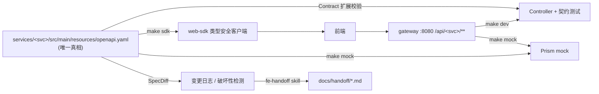

# harness-springboot

一个面向 **Claude Code / Codex** 的 Spring Boot 微服务 Harness Engineering 样板：
Spring Boot 3.5（Java 17，Maven 多模块）user / order / gateway 三个服务 + 契约优先 + 精简的 AGENTS.md / skills / hooks / subagent。

> Harness Engineering 的核心观点：**Agent 的产出质量 ≈ 它所处环境的反馈质量**。
> 与其在提示词里写"请注意 xxx"，不如把规则变成**可执行的检查**，在 Agent 犯错的那一刻就把错误信息喂回去。

---

## 1. 设计思路

### 1.1 三个原则

| 原则 | 落地 |
|---|---|
| **规则写成代码，不写成散文** | API 规范 → `SpecLint`；实现与契约一致 → `Contract`（JUnit 5 扩展）；兼容性 → `SpecDiff`；危险操作 → `guard.sh`。AGENTS.md 只保留"地图 + 不可违反的规则"。 |
| **反馈越快越好，越近越好** | 四层反馈：执行前拦截（PreToolUse）→ 编辑后秒级（PostToolUse）→ 结束前增量（Stop）→ 提交 / CI 全量。每层只做该层该做的事。 |
| **单一事实来源，向两端派生** | `openapi.yaml` 派生出：后端契约测试、前端 TS SDK、Prism mock、变更日志、交接文档。前后端只围绕契约协作。 |

### 1.2 架构



模块划分：

| 模块 | 作用 |
|---|---|
| `harness-contract` | 契约测试扩展 `Contract`、`SpecLint`、`SpecDiff`。只依赖 SnakeYAML + Jackson，额外打出 `*-cli.jar`，启动 <0.5s |
| `common-web` | Spring Boot **自动配置**：统一错误体、`@RestControllerAdvice`、request-id 过滤器、严格 JSON。服务引入依赖即生效，零代码 |
| `services/user` | 用户服务（record DTO + Bean Validation + 内存存储，`UserStore` 接口隔离持久化） |
| `services/order` | 订单服务，经 `RestClient` 调 user-service；依赖边界是 `UserClient` 接口，测试用 `@MockitoBean` |
| `services/gateway` | 前端唯一入口 `/api/{svc}/**`，剥离前缀反向代理 + CORS + request-id 贯穿 |

### 1.3 反馈分层（快速高质量迭代的关键）

| 层 | 触发 | 做什么 | 耗时（本机实测） | 失败时 |
|---|---|---|---|---|
| L0 守卫 | `PreToolUse` | 拦截 `push -f` / `--no-verify` / `reset --hard`、写生成文件 / `target/`、改 harness 自身 | ms | 阻止并说明原因 |
| L1 即时 | `PostToolUse` | `.java` → `mvn -pl <模块> -am compile`；`openapi.yaml` → speclint + 注入"下一步"提示 | 编译约 3–4s，lint <0.5s | 错误回灌，当轮修复 |
| L2 增量 | `Stop` | 只对**受影响模块**：speclint → contract-diff → `mvn -pl … -am test` | 单服务约 10s | 阻止结束，回灌**摘要后**的错误 |
| L3 全量 | git pre-commit / CI | `verify --all` + PR 对 base 的破坏性检测 + SDK 是否已重新生成 | 约 30s | 拒绝合并 |

**Java 特有的取舍**（面试常问）：
- Maven 比 Go 慢一个量级，所以 L1 **只编译不测试**（编辑几十次，每次跑测试不可接受），测试放到 L2；L2 用 `-pl … -am` 只构建受影响模块及其依赖。
- 改了 `common-web` / `harness-contract` / 根 `pom.xml` 才全量，因为共享模块会影响所有服务。
- `SpecLint`/`SpecDiff` 不走 Maven 插件，而是打成独立 fat jar（`spring-boot-maven-plugin` 的 `classifier=cli`），保证契约检查是秒级的。

其他细节：
- **防死循环**：Stop hook 读取 `stop_hook_active`，同一轮只拦一次，第二次放行交给人类。
- **错误摘要**：Maven 输出几百行，失败时只抽取 `<<< FAILURE`、`violates contract`、`.java:[行,列]`、`BREAKING` 等关键行，再给 8 行尾部上下文。
- **防自我放水**：Agent 不能修改 `.claude/settings.json`、`scripts/harness/`、`.githooks/`（人类用 `HARNESS_UNLOCK=1 claude` 解锁）。
- **不制造噪音**：测试已有失败时，契约覆盖率检查自动跳过，避免掩盖真正的错误。

### 1.4 契约测试（`harness-contract` 的 `Contract`）

```java
@SpringBootTest
@AutoConfigureMockMvc
class UserContractTest {
    @RegisterExtension
    static Contract contract = Contract.forSpec("src/main/resources/openapi.yaml");
    @Autowired MockMvc mvc;

    @Test
    void createUser() {
        User u = contract.on(mvc).post("/v1/users", Map.of("name", "Alice", "email", "a@x.io"))
                .expect(201).as(User.class);
    }
}
```

它机械保证三件事：
1. **路由必须在契约中声明**：实现里不可能悄悄多出一个接口；
2. **每个响应都按契约校验**（状态码是否已声明、字段、类型、必填、枚举、格式），实现与契约不会漂移；
3. **测试类结束时，契约里每个 operation 都至少被调用过一次**，不会出现"写了契约没测"。

### 1.5 为什么选择"运行时契约测试"而不是 openapi-generator 生成接口

两条路都是契约优先。这里选运行时校验，理由是：
- 生成代码会让 Agent 面对大量生成物（还要防它手改），上下文噪音大；
- 生成接口只保证**签名**一致，管不到**行为**（返回了契约没声明的状态码、漏了必填字段），而契约测试两者都能抓到；
- 零额外 Maven 插件，构建更快、更稳定。

如果团队已经在用 openapi-generator，也可以叠加使用：生成 `interfaceOnly` 的 `XxxApi` 让 Controller 去实现，`Contract` 继续负责行为校验。

### 1.6 前后端快速协作

| 前端痛点 | 方案 |
|---|---|
| 后端还没写完，前端动不了 | `make mock`：Prism 按契约里的 `example` 返回数据，地址就是同一个 gateway，后面切真实后端前端零改动 |
| 字段名、类型对不上 | `make sdk`：openapi-typescript + openapi-fetch，路径、参数、body、响应都在编译期做类型检查 |
| 后端悄悄改接口 | `SpecDiff`：删字段、改类型、新增必填都算 BREAKING，默认拒绝；只有提升主版本才放行 |
| 不知道这次改了什么 | `fe-handoff` skill：基于 contract-diff 生成固定格式的交接文档 |
| 错误处理五花八门 | 全局统一返回 `{code, message, requestId}`；JSON 解析错误不泄露类名；`code` 改名算破坏性变更 |
| 跨域、多端口 | gateway 统一入口 `/api/<svc>`，内置 CORS，透传 `X-Request-Id`，前后端可以按同一个 ID 对日志 |

### 1.7 为什么"精简"

| 组件 | 数量 | 取舍 |
|---|---|---|
| AGENTS.md | 1 份（约 50 行） | 只放地图、命令、7 条规则、DoD。Claude 通过 `CLAUDE.md` 的 `@AGENTS.md` 复用，Codex 原生读取，**只维护一份** |
| Skills | 3 个 | `api-change` / `new-service` / `fe-handoff`，按需加载，不常驻上下文 |
| Hooks | 3 个事件 | Pre（守卫）/ Post（即时）/ Stop（增量门）。逻辑全在 `scripts/harness/*.sh`，hook 只是调用方 |
| Subagent | 1 个 | `reviewer`：只读，独立上下文，带 Java/Spring 检查清单，避免"自己审自己" |

**跨工具复用**：Claude Code 通过 hooks 调用这些脚本；Codex 和人类通过 `make verify` 与 git pre-commit 调用；CI 调用 `verify --all`。`.agents/skills` 是指向 `.claude/skills` 的软链。

---

## 2. 如何使用

### 2.1 准备
```bash
# 依赖：JDK 17+、Maven 3.9+、Node 18+（仅 sdk/mock 需要）、jq（可选）
make setup        # 启用 git hooks + mvn install（安装 harness-contract / common-web）
make help
```
IntelliJ IDEA：直接 Open 根目录的 `pom.xml`，作为 Maven 项目导入即可。

### 2.2 Claude Code
```bash
claude            # 自动加载 CLAUDE.md(→AGENTS.md)、.claude/settings.json(hooks)、skills、agents
```
典型对话：
```
> 给订单增加可选字段 currency（ISO 4217），前端下周要用
  # 选用 api-change skill：改 openapi.yaml → speclint 即时检查 → 改 record DTO + Controller
  # → 补契约测试 → Stop hook 跑增量 verify → make sdk → fe-handoff 产出交接文档
> 用 reviewer 子代理审一下这次改动
> 新建一个 payment 服务，负责支付单
  # new-service skill → make new-service NAME=payment → 模块已注册到根 pom 且测试通过
```

### 2.3 Codex
```bash
make hooks        # 一次性：git pre-commit 走同一套 verify
codex             # 读取 AGENTS.md；DoD 要求结束前运行 make verify
```

### 2.4 人类 / 前端
```bash
make dev          # 真实服务：gateway :8080，order :8081，user :8082
make mock         # 纯 mock（Prism），前端立即可联调
make sdk          # 生成 web-sdk/src/gen（前端 import "@harness/web-sdk"）
make contract-diff
make up           # docker compose
MVN="mvn -o" make verify   # 离线加速
```

---

## 3. 演示（均已实测）

```text
# ① 实现漂移：把 record User 的 email 改名为 mail，Agent 尝试结束
verify FAILED at step [mvn test (services/user)]:
  UserContractTest.createGetAndList:33 response violates contract for POST /v1/users (status 201):
  - $: required property 'email' is missing

# ② 契约不规范：删掉 getOrder 的 operationId（PostToolUse 当场反馈，<0.5s）
services/order/src/main/resources/openapi.yaml: GET /v1/orders/{id}: missing operationId (前端 SDK 方法名来源)

# ③ 编译错误（PostToolUse，约 3.6s）
compile failed after editing .../UserController.java:
[ERROR] .../UserController.java:[47,21] cannot find symbol
[ERROR]   symbol:   method findd(java.lang.String)

# ④ 破坏性变更：createOrder 新增必填字段 currency
verify FAILED at step [contract-diff]:
  [BREAKING]  POST /v1/orders  request: new required field currency
# 改为可选                → [added/changed] request: new optional field currency      ✓
# 或 info.version → 2.0.0 → 1 breaking change(s) allowed: major version bumped        ✓

# ⑤ 未声明的路由 / 漏测的 operation
DELETE /v1/users/u_1 is not declared in the contract: method not declared for this path
contract coverage: operations never exercised by tests: [createUser (POST /v1/users), getUser (GET /v1/users/{id})]

# ⑥ 守卫
BLOCKED by harness guard: --no-verify skips quality gates; fix the failure instead
BLOCKED by harness guard: scripts/harness/verify.sh is part of the harness; agents may not loosen their own guardrails
```

---

## 4. 目录

```
pom.xml                          # 父 POM（spring-boot-starter-parent 3.5.16）
AGENTS.md  CLAUDE.md
.claude/settings.json            # 权限白名单 + 3 个 hooks
.claude/skills/{api-change,new-service,fe-handoff}/SKILL.md
.claude/agents/reviewer.md
.agents/skills -> .claude/skills
scripts/harness/                 # guard / post-edit / verify / contract-diff / contract-cli（harness 核心）
scripts/dev/                     # run(dev|mock) / sdk / new-service / services 注册表
harness-contract/                # Contract（JUnit5 扩展）、SpecLint、SpecDiff、OpenApi、SchemaValidator
common-web/                      # ApiException、GlobalExceptionHandler、RequestIdFilter、自动配置
services/{user,order,gateway}/
templates/service/               # new-service 模板
web-sdk/                         # 前端 SDK（src/gen 为生成物）
docs/handoff/                    # 前端交接文档
.githooks/pre-commit  .github/workflows/ci.yml  Dockerfile  docker-compose.yml
```

## 5. 扩展方向

- 持久化：`UserStore` 已是接口，可换成 Spring Data JPA，再加一条 hook 拦截不可回滚的 Flyway 迁移。
- 网关：生产环境换成 Spring Cloud Gateway（限流、熔断、鉴权），契约与 harness 不变。
- 质量门：在 L3 加 JaCoCo 覆盖率阈值、ArchUnit 分层规则（例如"服务之间禁止互相依赖"），把更多规则从文档搬到代码里。
- 可观测：request-id 已写入 MDC，可接 Micrometer Tracing / OpenTelemetry。
